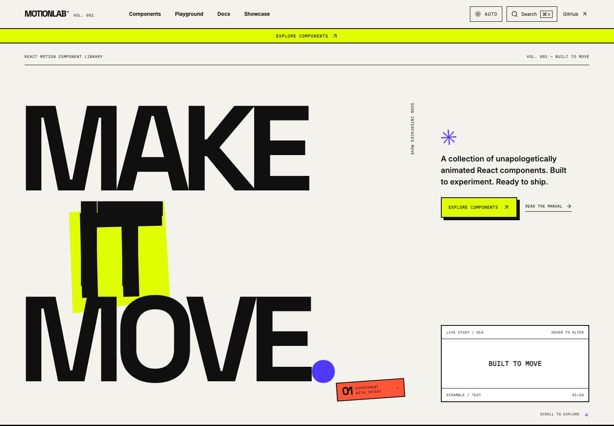
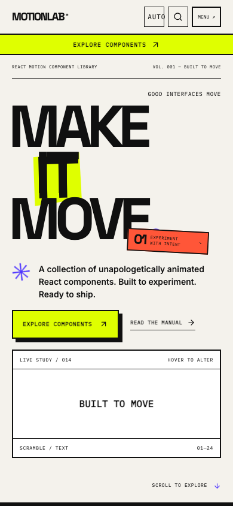

# MOTIONLAB®

**Motion-first React components with an unapologetic point of view.**

MotionLab is an open-source library of original, interactive React components, with a live catalog, a prop playground, implementation notes, and a shadcn-compatible source registry.

> Repository status: the source is published in a public GitHub repository. Pushing to `main` builds and deploys the site to GitHub Pages.



<details>
<summary>Mobile preview</summary>


</details>

## Explore

- **24 components** across text, interaction, cards, navigation, and backgrounds.
- **Own the source:** install individual components and edit them in your application.
- **Live documentation:** demos, API props, examples, and accessibility notes.
- **Playground:** adjust real props, persist locally, share a URL, and copy generated TSX.
- **Reduced motion:** animated components honor the user's motion preference.
- **No account or service:** the registry serves static source files.

## Install a component

To try the registry locally, start MotionLab in one terminal:

```sh
pnpm install
pnpm dev
```

Then install a component from another terminal:

```sh
pnpm dlx shadcn@latest add http://localhost:3000/r/magnetic-button.json
```

In a Next.js app, use the generated source as a client component where required by Motion:

```tsx
import { MagneticButton } from "@/components/ui/magnetic-button";

export function HeroAction() {
  return <MagneticButton>Explore components ↗</MagneticButton>;
}
```

The registry declares `motion` for components that need it. The receiving project must have a compatible React setup and the aliases expected by its `components.json`.

## Run MotionLab locally

Requirements: Node.js 22 or newer and pnpm 11.

```sh
pnpm install
pnpm dev
```

Open `http://localhost:3000`. Useful project commands:

```sh
pnpm lint
pnpm typecheck
pnpm test
pnpm registry:check
pnpm build
pnpm exec playwright install chromium
pnpm test:e2e
```

Set `NEXT_PUBLIC_SITE_URL` to the deployed canonical URL for a populated sitemap and public install commands. Set `NEXT_PUBLIC_REPOSITORY_URL` after publishing to show a GitHub link. The default local experience does not need environment variables.

## Project map

```text
apps/web/                  Next.js catalog, docs, playground, and showcase
packages/ui/               Independent React component source and unit tests
tests/e2e/                 Playwright flows and responsive layout checks
scripts/                   Registry generation and schema validation
registry.json              Root shadcn registry manifest
```

The component metadata in `apps/web/src/lib/component-registry.ts` feeds the catalog, detail pages, examples, and registry generator. Component source lives in one file per component under `packages/ui/src/components/`.

## Quality and release

GitHub Actions runs install, lint, strict type checking, unit tests, registry validation, production build, and browser tests. Merging or pushing to `main` also builds a static export and deploys it to GitHub Pages. The Pages workflow sets the project base path, canonical site URL, and repository link from GitHub's workflow context. Check that `/r/registry.json` and `/r/magnetic-button.json` return JSON on the published site before sharing install commands.

After the first successful Pages deployment, the component detail pages provide install commands that point to the hosted registry.

## Roadmap

- Expand component-level keyboard and reduced-motion coverage as the library grows.

## Contributing

Read [CONTRIBUTING.md](CONTRIBUTING.md), [CODE_OF_CONDUCT.md](CODE_OF_CONDUCT.md), and [SECURITY.md](SECURITY.md) before opening a contribution. The current version and implementation notes are in [CHANGELOG.md](CHANGELOG.md).

## License

Original MotionLab source is available under the [MIT License](LICENSE). MotionLab does not copy or redistribute React Bits code. Third-party dependencies retain their own licenses.

---

**GO BUILD SOMETHING THAT MOVES.**
